<p align="center">
  
</p>

<h1 align="center">TimePulse</h1>

<p align="center">
  <strong>致力于成为最美观、优雅且沉浸的现代化多功能计时器、时光管理与专注陪伴工作台。</strong>
  <br />
  <em>An aesthetic, customizable, and immersive multi-functional time manager, focus timer & desktop companion.</em>
</p>

<p align="center">
  <a href="https://github.com/AlkaidSTART/TimePulse/releases"></a>
  <a href="https://time-pulse-two.vercel.app/"></a>
  <a href="LICENSE"></a>
  
  
  
  
  
  
  
</p>

> [!NOTE]
> 💡 本项目是基于开源先驱 [RavelloH/TimePulse](https://github.com/RavelloH/TimePulse) 的独立二次开发版本（非官方）。在此基础上进行了工业级工程重构，深度拓展了**元气打气与节气问候、短期番茄专注、待办核对清单与悬浮微挂件、极简沉浸禅模式、账号安全与 Supabase 云同步系统**，并全面支持 **Tauri v2 跨平台原生客户端（macOS / Windows / Android）**。

---

## 目录 (Table of Contents)

- [🌟 在线体验与客户端下载](#-在线体验与客户端下载)
- [✨ 核心功能亮点](#-核心功能亮点)
- [📸 界面与功能视觉全景](#-界面与功能视觉全景)
- [🛠️ 技术架构与工程设计](#️-技术架构与工程设计)
- [🚀 快速开始与本地运行](#-快速开始与本地运行)
- [☁️ Supabase 云端与环境配置](#️-supabase-云端与环境配置)
- [📦 跨平台客户端构建 (Tauri v2)](#-跨平台客户端构建-tauri-v2)
- [📂 项目仓库组织架构](#-项目仓库组织架构)
- [🧪 自动化测试与质量保证](#-自动化测试与质量保证)
- [🗺️ 项目演进路线图](#️-项目演进路线图)
- [🤝 参与贡献与社区规范](#-参与贡献与社区规范)
- [📄 开源许可与致谢](#-开源许可与致谢)

---

## 🌟 在线体验与客户端下载

TimePulse 提供即开即用的网页版与覆盖主流操作系统的原生桌面/移动端安装包：

- 🌐 **Web 在线体验版**：[https://time-pulse-two.vercel.app/](https://time-pulse-two.vercel.app/)
- 📱 **移动端扫码即用**：手机相机直接扫描下方二维码，或选择“添加到主屏幕”作为 PWA 应用离线使用。

<div align="center">
  
  <p><em>手机扫码即可直接体验 TimePulse 在线版</em></p>
</div>

### 原生客户端安装包 (Tauri v2)

欢迎前往 [GitHub Releases 页面](https://github.com/AlkaidSTART/TimePulse/releases) 获取经过 GitHub Actions 自动化编译输出的各平台原生安装程序：

| 平台 | 安装包格式 | 架构 / 系统要求 | 说明 |
| :--- | :--- | :--- | :--- |
| 🍏 **macOS** | `.dmg` | Universal (Apple Silicon M1-M4 & Intel x86_64) | 支持原生毛玻璃窗口、系统级通知与快捷键 |
| 🪟 **Windows** | `.exe` | 64-bit (Windows 10 / 11) | 极简现代化 NSIS 安装向导，启动飞速 |
| 🤖 **Android** | `.apk` | arm64-v8a (Android 8.0+) | 原生触感反馈（Haptics）、手势滑动、常驻保活与通知通道 |
| 🌐 **Web / PWA** | Web App | 现代 Chromium / Safari / Firefox 核心 | 支持 Service Worker 离线缓存与全屏桌面挂件 |

---

## ✨ 核心功能亮点

### 1. 🕒 全能时光计时矩阵 (Multi-Mode Timer Suite)
- **长期目标倒数日**：跨年、高考、考试、项目发版、重要纪念日。天、时、分、秒丝滑跳动，配有圆环与平滑百分比进度条。
- **短期专注番茄钟**：专为番茄工作法（Pomodoro）与短时冲刺优化，支持快捷设定 25/15/5 分钟，翡翠绿与玫瑰粉专属专注主题。
- **正计时与毫秒级秒表**：支持分秒累计与分圈计次（Lap Times），精准捕捉任务执行节奏。
- **全球跨时区世界时钟**：内置全球主要城市时区库，跨国协作与旅程安排时刻胸有成竹。

### 2. ☀️ 元气打气与时光问候 (Daily Greeting & Cheer Space)
- **农历公历智能转换**：基于算法自动推算农历月份、二十四节气与中外传统节假日。
- **时段动态感知**：自动感知晨曦微露、午后惬意、暮色温柔、静谧深夜等时段，呈现温润定制问候语。
- **每日精选灵感名言**：本地经典语录库与 Supabase 云端名言库双轨互补，支持即时随机“换一换”与一键复制。
- **元气打气弹跳动效**：充满活力的轻触打气反馈与连击微动效，给予日常前行满满正能量。

### 3. 📝 待办核对清单与挂件视图 (Todo & Micro-Widget)
- **三级优先级色彩标签**：紧急（烈焰红）、优先（琥珀黄）、普通（翡翠绿），任务轻重缓急一目了然。
- **专注核对清单模式**：支持待办项与核对清单（Checklist）双态切换，支持拖拽排序与快捷勾选打卡。
- **完成进度实时统计**：实时环比计算任务完成率，完成状态动效细腻，附带测试震动提醒。
- **桌面常驻悬浮微挂件**：可一键收拢为屏幕角落实时微挂件（Widget），边专注边对照，不占视野。

### 4. 🧘 沉浸极简禅模式 (Zen Fullscreen Clock)
- **一键纯净时钟**：自动淡出 Header、底部 Dock 与全部干扰交互，让屏幕回归纯粹的时间流淌。
- **防烧屏微位移与屏保优化**：轻柔的视觉呼吸感，适合作为工作台工位时钟或床头夜钟。
- **轻触即退**：双击或轻触任意空白区域即刻唤醒控制台。

### 5. 🎨 现代高级视觉美学与深度定制 (Aesthetics & Customization)
- **三套基础质感主题**：羊脂米白 (Cream) / 纯净雅白 (Light) / 曜石深黑 (Dark)。
- **多套高定强调色**：翡翠绿、经典蓝、玫瑰粉、琥珀橙、紫罗兰自由切换。
- **自定义壁纸与毛玻璃**：支持本地图片上传、在线图床 URL，精细调节高斯模糊度（Blur）与背景透明度（Opacity）。

### 6. ☁️ 账号体系与多端云同步 (Supabase BaaS & Dual-Track Storage)
- **TLS 工业级安全认证**：基于 Supabase BaaS，支持邮箱注册登录、Google / GitHub 第三方 OAuth 快速连接。
- **双向增量云同步**：本地计时器变更即时上云，多设备登录自动合并最新状态。
- **云端个人主页与头像存储**：专属 `touxiang` 存储桶，客户端自动压缩裁剪为 256×256 WebP（体积减少 85%），省流且疾速加载。
- **平台自适应双轨存储引擎**：
  - **Web 端**：采用 **IndexedDB v3** 存储大数据与壁纸，辅以 LocalStorage 容灾备份。
  - **Tauri 原生端**：采用 **SQLite** 原生数据库（`tauri-plugin-sql`），具备极致 IO 性能与断电可靠性。
  - **断网全功能离线运行**：数据完全持久化于本地，保护用户隐私。

---

## 📸 界面与功能视觉全景

### 1. 元气打气与时光问候 (Cheer & Daily Greeting)
公历与农历智能对照，结合时段问候、每日灵感名言、元气打气卡片与跨年倒数提醒。

<div align="center">
  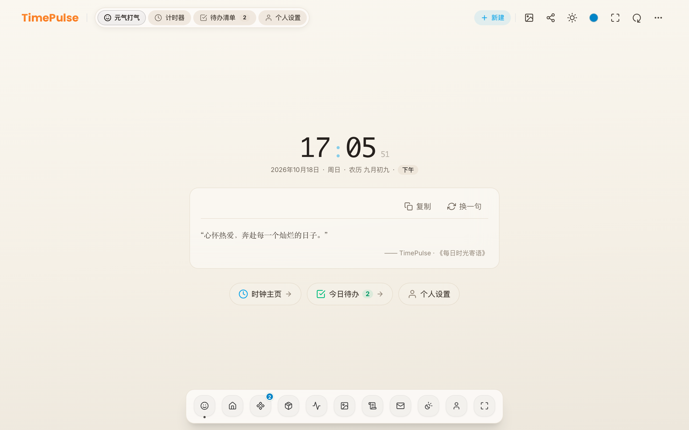
</div>

---

### 2. 多场景计时器矩阵 (Multi-Mode Timers)
满足不同工作与生活节奏下的计时需求，支持多计时器平滑卡片切换。

| 长期目标倒数日 (Countdown) | 短期专注番茄钟 (Pomodoro / Short Focus) |
| :---: | :---: |
| 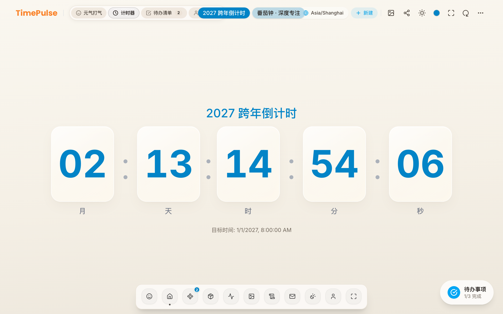 | 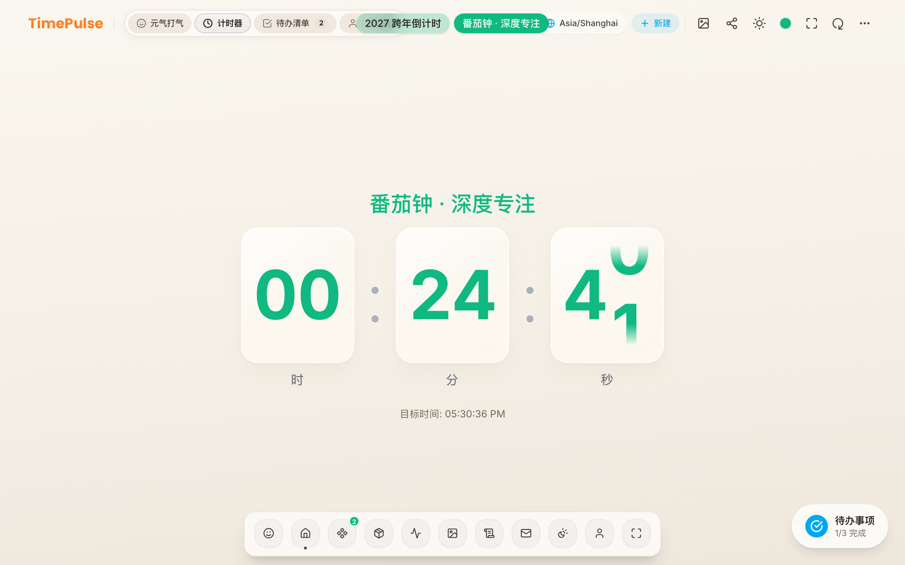 |
| 精确到天/时/分/秒，配有进度条与动态色彩 | 极简短时倒数，经典番茄钟，翡翠绿专注主题 |

| 新建计时器向导 (Create Timer) | 极简沉浸禅模式 (Zen Fullscreen) |
| :---: | :---: |
| 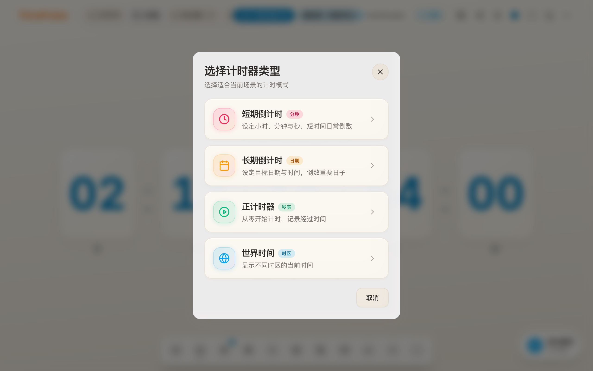 | 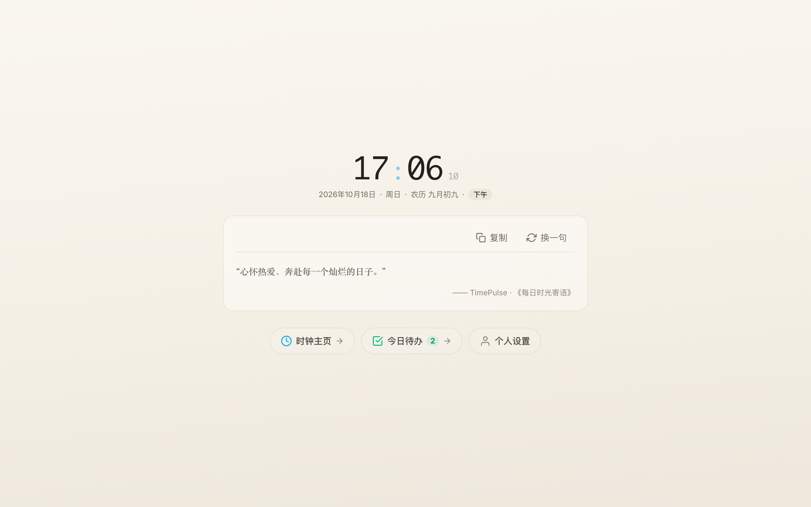 |
| 支持短期倒计时、长期倒计时、秒表与世界时钟 | 一键隐藏全部工具栏与干扰元素，沉浸专注当下 |

---

### 3. 待办核对清单与悬浮挂件 (Todo Checklist & Widget)
内置待办清单与高效核对工具，支持三级优先级色标、划线完成动画、完成率百分比进度与常驻微挂件。

<div align="center">
  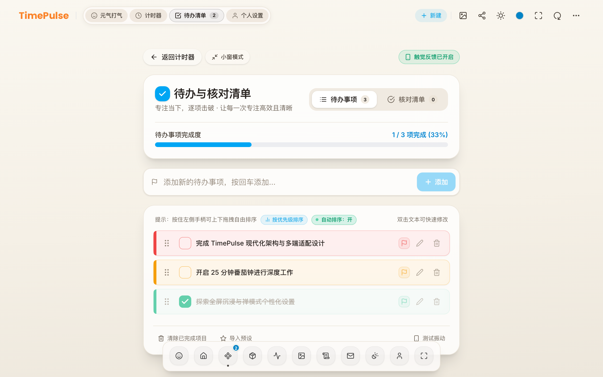
</div>

---

### 4. 账号中心与多端云同步 (Account & Cloud Sync)
基于 Supabase BaaS 打造的现代化用户中心，涵盖邮箱验证、TLS 加密登录注册、个人资料管理与头像上传。

| 账号登录与注册认证中心 | 个人账号管理与多端云同步状态 |
| :---: | :---: |
| 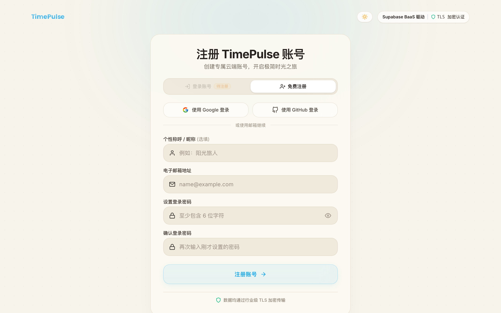 | 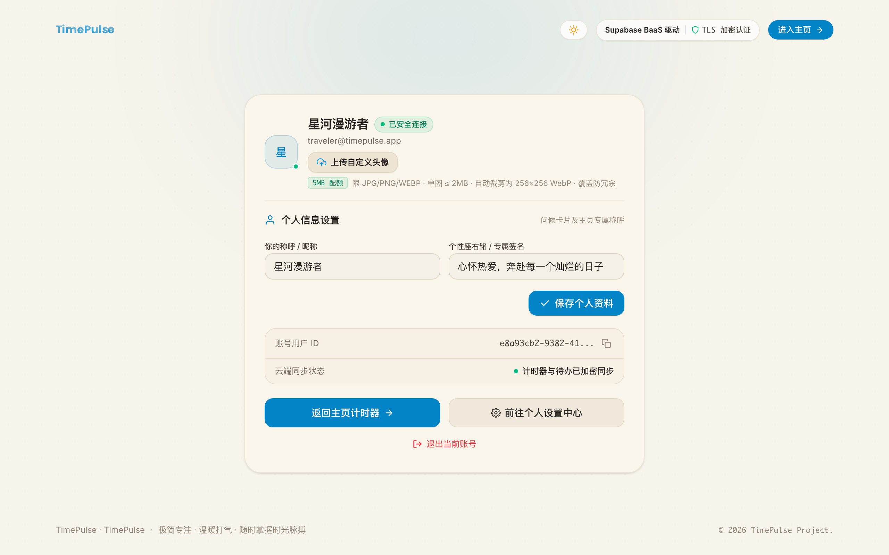 |
| 优雅表单校验、防暴力重试、OAuth 一键登录 | 个人资料修改、云端头像裁剪直传、多端同步状态实时监控 |

---

### 5. 个性化设置与微调弹窗 (Personalization & Modals)

| 个人中心与偏好设置 | 自定义背景与毛玻璃微调 | 实时分享与二维码生成 |
| :---: | :---: | :---: |
| 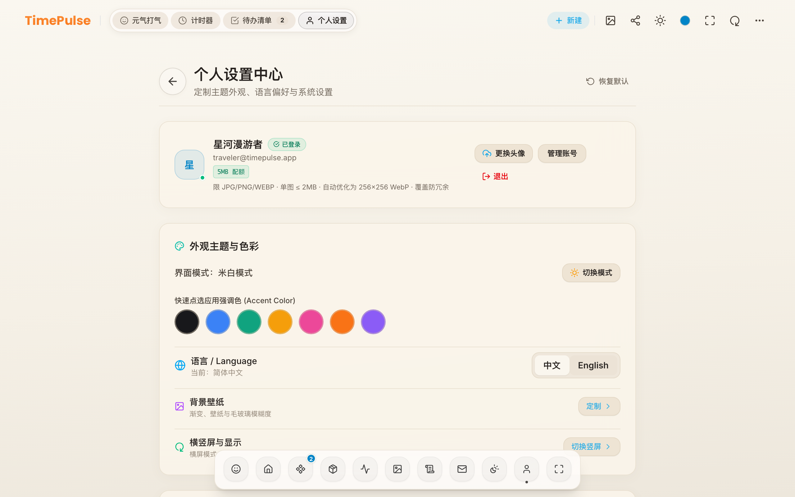 | 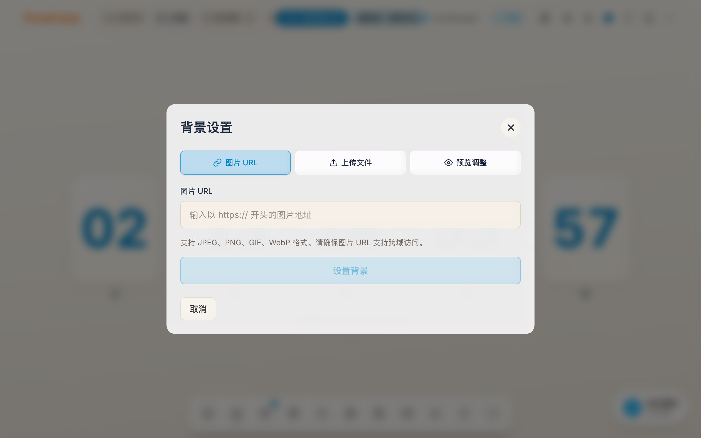 | 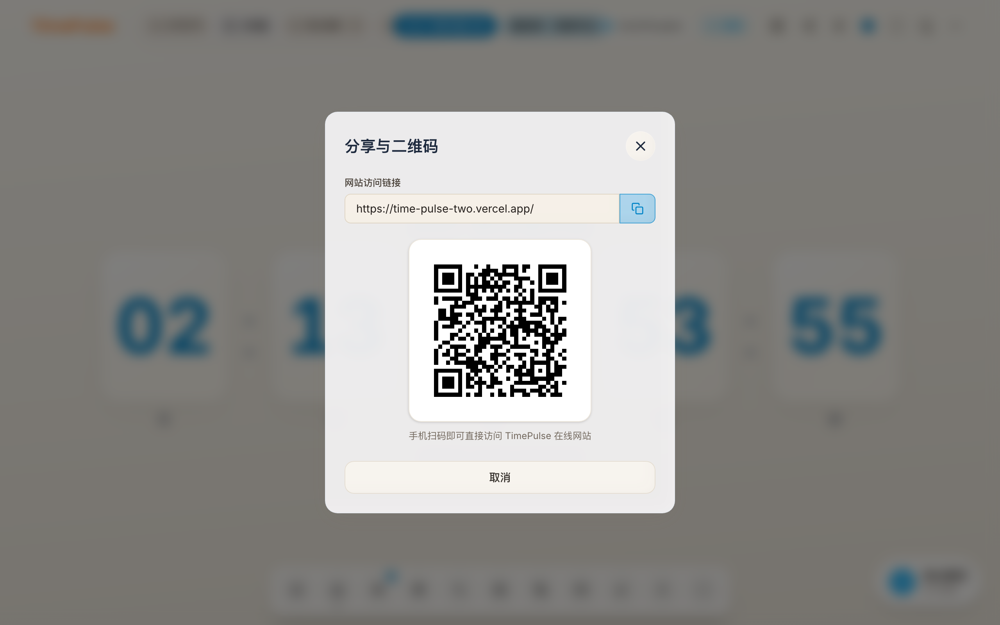 |
| 专属主题、色板、声音、震动与系统偏好 | 本地壁纸上传、图床 URL、模糊度调节 | 动态生成加密分享链接与二维码 |

---

### 6. 移动端原生触感与多端自适应 (Mobile & Responsive)
针对移动端小屏与手势触控深度调优，配备原生质感的底部浮动 Dock 与全局手势导航。

<div align="center">
  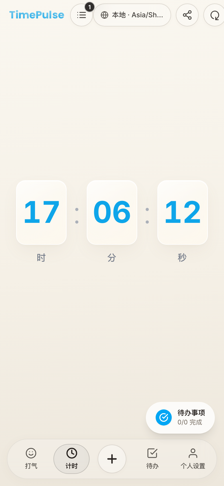
</div>

---

## 🛠️ 技术架构与工程设计

### 架构拓扑图 (Architecture Overview)

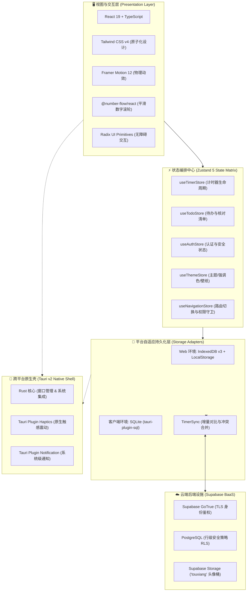

### 核心技术栈清单

| 类别 | 选用技术 / 库 | 版本 | 核心作用与设计考量 |
| :--- | :--- | :--- | :--- |
| **基础内核** | [React](https://react.dev/) | `19.3.0` | 采用全新编译器与并发特性，零无用重渲染 |
| **语言规范** | [TypeScript](https://www.typescriptlang.org/) | `5.9.x` | 严格模式，类型全覆盖，从组件到数据库全链路类型安全 |
| **构建系统** | [Vite](https://vitejs.dev/) | `8.2.x` | 秒级极速热重载 (HMR)，Rollup / Rolldown 模块智能分包 |
| **样式引擎** | [Tailwind CSS](https://tailwindcss.com/) | `v4.3.x` | 基于全新 Oxide 引擎的原子化毛玻璃与现代色彩系统 |
| **状态管理** | [Zustand](https://github.com/pmndrs/zustand) | `5.0.x` | 轻量化、解耦的状态切片，无 Context 嵌套地狱 |
| **动效库** | [Framer Motion](https://www.framer.com/motion/) | `12.43.x` | 物理弹性缓动动画，提供自然顺滑的手势拖拽和页面过渡 |
| **数字动效** | [@number-flow/react](https://number-flow.barvian.me/) | `0.6.2` | 专为倒计时设计的高性能平滑数字滚轮翻转动效 |
| **本地存储** | IndexedDB / SQLite | Native | 平台自适应抽象层，浏览器端使用 IndexedDB，原生客户端直连 SQLite |
| **云端后端** | [Supabase](https://supabase.com/) | `^2.118` | 提供 Postgres 数据库、RLS 权限策略、GoTrue 身份认证与对象存储 |
| **原生跨平台** | [Tauri](https://v2.tauri.app/) | `v2.9.x` | 基于 Rust 的超轻量级、高安全客户端包装方案，内存占用仅为 Electron 的 1/5 |
| **测试框架** | Vitest + Playwright | 最新稳定版 | Vitest 提供单元与集成测试，Playwright 负责端到端与文档自动化截图 |

---

## 🚀 快速开始与本地运行

### 环境准备

在开始之前，请确保本地已安装：
- **Node.js**：`>= 22.13.0` (推荐使用 `nvm` 或 `fnm` 安装)
- **pnpm**：`>= 11.0.0` (`npm i -g pnpm`)
- *(可选)* **Rust & Cargo**：如需本地编译桌面原生应用 (推荐 Rust `>= 1.80`)

### 1. 克隆代码仓库

```bash
git clone https://github.com/AlkaidSTART/TimePulse.git
cd TimePulse
```

### 2. 安装项目依赖

```bash
pnpm install
```

### 3. 配置本地环境变量

复制环境变量模版并按需配置（详见下文云服务配置）：

```bash
cp .env.example .env.local
```

### 4. 启动本地开发服务

```bash
pnpm dev
```

启动完成后，打开浏览器访问控制台输出的地址（默认为 `http://localhost:5173`）即可开始体验。

### 5. 生产构建与预览

```bash
# 执行类型检查与生产环境打包
pnpm build

# 本地启动静态服务器预览产物
pnpm preview
```

### 6. 全自动捕获文档高清截图

项目内置了 Playwright 驱动的自动化截图脚本，可一键复现全部 12 张文档高清大图：

```bash
# 自动启动内置预览服务器并截取高清界面至 docs/screenshots/
pnpm capture:screenshots
```

---

## ☁️ Supabase 云端与环境配置

TimePulse 支持纯离线使用，同时也内置了强大的 Supabase 云端同步服务。如需自建或连接 Supabase 项目，请参考以下环境变量说明：

### 环境变量 (`.env.local` / `.env`)

```ini
# Supabase 项目 API 地址
VITE_SUPABASE_URL=https://your-project-ref.supabase.co

# Supabase 公开可访问的 Publishable API 密钥 (Anon Key)
VITE_SUPABASE_PUBLISHABLE_KEY=sb_publishable_your_key_here
```

### 数据库迁移 (Migrations)

数据库迁移脚本位于 `supabase/migrations/`，涵盖了：
- `20261018063837_create_timepulse_cloud_tables.sql`：云端计时器、同步表与行级安全策略（RLS）。
- `20261018075500_create_app_versions.sql`：客户端版本管理与自动检查更新。
- `20261018080000_storage_touxiang_policies.sql`：用户专属头像存储桶权限隔离策略。
- `20261018081500_create_inspirational_quotes.sql`：每日名言灵感题库表。

你可以通过 Supabase CLI 或控制台 SQL Editor 执行上述迁移脚本一键完成云端基础设施初始化。

---

## 📦 跨平台客户端构建 (Tauri v2)

TimePulse 采用了现代跨平台框架 **Tauri v2**，可直接将 Web 端应用封装为各操作系统的极速原生客户端。

### 1. 桌面端构建 (macOS / Windows)

```bash
# 构建适用于当前操作系统的生产包
pnpm tauri build
```

- **macOS**：产出物位于 `src-tauri/target/release/bundle/dmg/`，支持 Apple Silicon 与 Intel 架构。
- **Windows**：产出物位于 `src-tauri/target/release/bundle/nsis/`，支持一键安装与自升级。

### 2. Android 移动端构建

需要预先配置好 `JAVA_HOME`、`ANDROID_HOME` 与 `NDK` 环境变量：

```bash
# 初始化 Android 工程模版
pnpm tauri android init

# 生成 Android APK 安装包
pnpm tauri android build --apk
```

产出物位于 `src-tauri/gen/android/app/build/outputs/apk/release/`。

> [!TIP]
> **版本号同步机制**：本项目提供了自动化脚本 `pnpm version:sync`，根目录 `package.json` 中的版本号在构建前会自动同步更新到 `src-tauri/tauri.conf.json` 与 `src-tauri/Cargo.toml`。

---

## 📂 项目仓库组织架构

```
TimePulse/
├── docs/                     # 项目设计文档与高清展示截图
│   └── screenshots/          # 自动化截取的 12 张文档大图
├── public/                   # 静态公开资源 (图标、PWA manifest、宣传二维码)
├── scripts/                  # 自动化维护与构建脚本
│   ├── capture-docs-screenshots.mjs  # Playwright 自动化文档截图脚本
│   ├── sync-github-releases.mjs      # 同步 GitHub Releases 发布信息
│   ├── sync-tauri-version.mjs        # 同步多端版本号到 Tauri 配置
│   └── seed-quotes.mjs               # 灵感名言数据库种子脚本
├── src/                      # 前端源代码根目录
│   ├── app/                  # 应用顶层容器、Providers 与布局组装
│   ├── components/           # 全局通用 UI 原语与布局组件
│   ├── domain/               # 核心领域实体与接口模型 (Timer, User 等)
│   ├── features/             # 领域业务特性模块 (垂直切片)
│   │   ├── auth/             # 用户认证、安全登录、注册与资料管理
│   │   ├── background/       # 壁纸管理、图床导入与毛玻璃调节
│   │   ├── cheer/            # 元气打气、时光寄语与节气农历问候
│   │   ├── countdown/        # 倒数日与长期计时器展示引擎
│   │   ├── fullscreen/       # 沉浸极简禅模式全屏控制器
│   │   ├── notification/     # 通知推送与离线状态监控
│   │   ├── settings/         # 个人中心、系统偏好设置
│   │   ├── sharing/          # 实时卡片分享与二维码生成
│   │   ├── stopwatch/        # 毫秒级秒表与分圈计时
│   │   ├── timer-management/ # 计时器创建向导、多类型计时切换
│   │   ├── todo/             # 待办清单、核对清单与悬浮挂件
│   │   └── world-clock/      # 跨时区世界时钟
│   ├── hooks/                # 自定义 React Hooks (手势触控、快捷键等)
│   ├── i18n/                 # 国际化多语言方案 (中文 / 英文)
│   ├── lib/                  # 第三方客户端实例封装 (Supabase 等)
│   ├── services/             # 核心服务 (存储适配器、云端同步、震动等)
│   │   ├── db/               # IndexedDB 与 SQLite 多后端持久化封装
│   │   ├── timerSync.ts      # 计时器增量云同步与冲突解决策略
│   │   ├── quotes.ts         # 灵感名言加载与缓存策略
│   │   └── notifications.ts  # 多端通知通道调度
│   └── stores/               # Zustand 全局状态管理切片
├── src-tauri/                # Tauri v2 客户端 Rust 原生工程
│   ├── Cargo.toml            # Rust 依赖声明
│   ├── tauri.conf.json       # Tauri 客户端核心配置
│   └── src/                  # Rust 原生插件与主入口
├── supabase/                 # Supabase 数据库迁移脚本与配置
├── tests/                    # 端到端测试与集成测试用例
└── package.json              # 项目依赖清单与 NPM Scripts
```

---

## 🧪 自动化测试与质量保证

为了确保项目的健壮性，TimePulse 配备了全面的自动化质量保证套件：

```bash
# 1. 运行 TypeScript 静态类型检查
pnpm typecheck

# 2. 运行 ESLint 代码规范检查
pnpm lint

# 3. 运行 Vitest 单元与集成测试
pnpm test

# 4. 运行 Playwright 端到端 (E2E) 测试
pnpm test:e2e
```

所有的核心模块（包括 `timerSync` 云同步、`quotes` 题库缓存、`vibration` 触觉调度、`AuthPage` 表单校验、`IndexedDB` 读写）均有高覆盖率的自动化测试守护。

---

## 🗺️ 项目演进路线图

- [x] **v0.5.0**：现代化前端重构，接入 Tailwind CSS v4 与 Framer Motion 动效引擎。
- [x] **v0.6.0**：引入待办核对清单、桌面常驻微挂件（Widget）与极简沉浸禅模式。
- [x] **v0.7.0**：
  - [x] 接入 Supabase BaaS，支持 TLS 邮箱认证、Google / GitHub OAuth 登录。
  - [x] 多端计时器数据增量双向云同步与冲突解决机制。
  - [x] 个人中心头像上传与 WebP 自动无损压缩直传。
  - [x] 完成 Tauri v2 跨平台包装，发布 macOS、Windows 与 Android 安装包。
  - [x] 编写全自动化 Playwright 文档截图流水线。
- [ ] **v0.8.0 规划**：
  - [ ] 桌面端悬浮独立画中画“灵动微时钟”窗口（Floating Mini-Island）。
  - [ ] iOS TestFlight 原生客户端适配。
  - [ ] 私有云 WebDAV 与自建 S3 兼容对象存储同步通道。
  - [ ] 更多自然白噪音与专注白噪音音效包（雨声、壁炉、森林、潮汐）。

---

## 🤝 参与贡献与社区规范

非常欢迎任何形式的代码贡献、问题反馈与创意点子！

1. **提交 Bug 或功能建议**：欢迎前往 [GitHub Issues](https://github.com/AlkaidSTART/TimePulse/issues) 提交你的反馈。
2. **提交代码改进**：
   - Fork 本仓库。
   - 创建你的特性分支（`git checkout -b feature/amazing-feature`）。
   - 提交你的代码（`git commit -m 'feat: add some amazing feature'`）。
   - 推送至分支（`git push origin feature/amazing-feature`）。
   - 发起 Pull Request。

在提交 Pull Request 前，请确保执行 `pnpm typecheck` 与 `pnpm test` 保证测试全部通过。

---

## 📄 开源许可与致谢

本项目遵循 [MIT 许可证](LICENSE) 开源。

二次开发源自开源项目 [RavelloH/TimePulse](https://github.com/RavelloH/TimePulse)，特此向原作者 [RavelloH](https://github.com/RavelloH) 及所有贡献者致以崇高的敬意与感谢。

<p align="center">
  Made with ❤️ by <a href="https://github.com/AlkaidSTART">AlkaidSTART</a> & Open Source Community.
</p>
